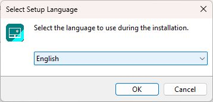
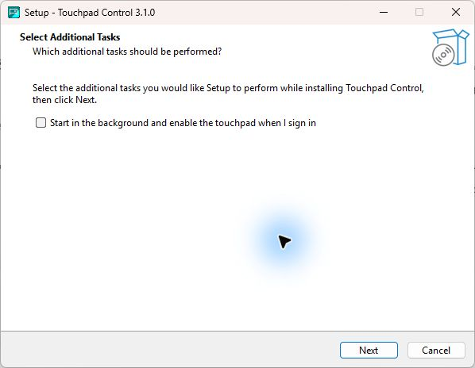
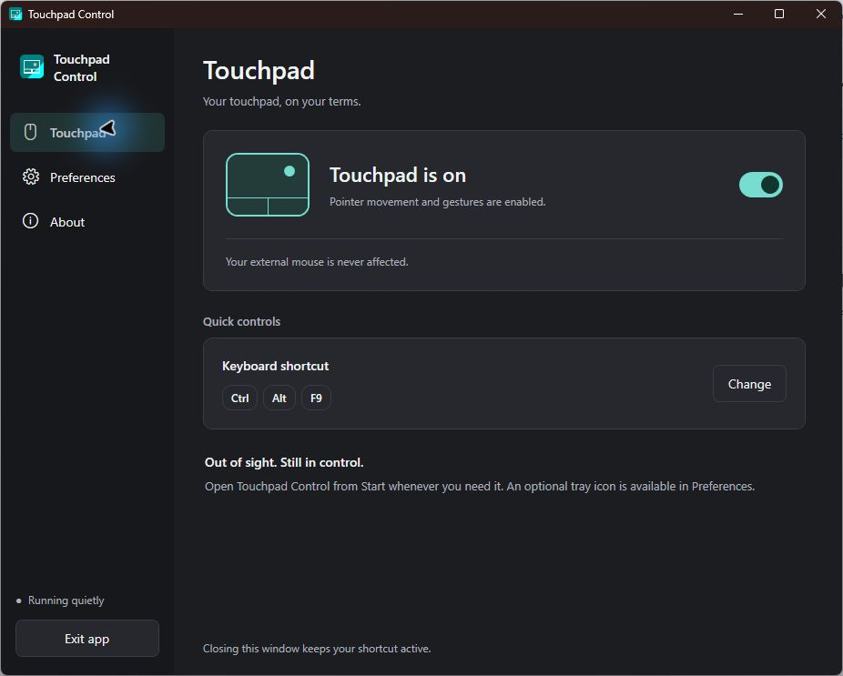
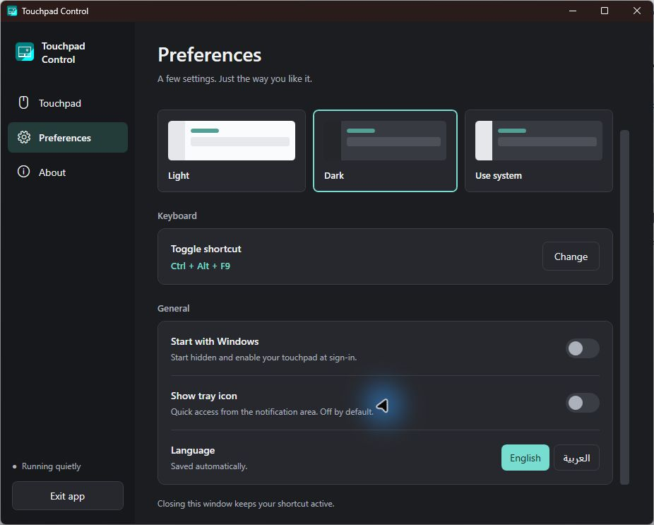
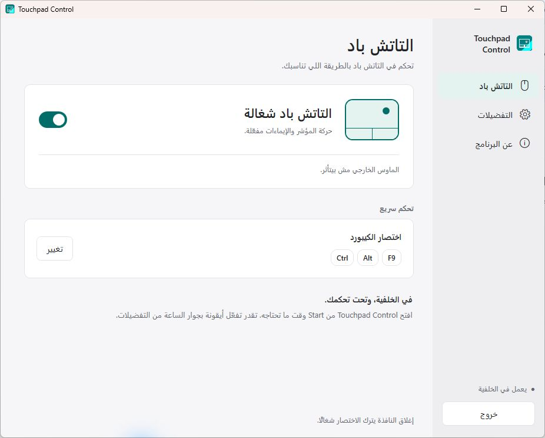

# Touchpad Control

A small Windows app that lets you turn your laptop touchpad on or off with a keyboard shortcut. Keep typing, working, or playing without accidental touches, while your external mouse remains available.

**Windows 10 / 11 · English & Arabic · Light, Dark & System themes · Works offline**

## Download and install

**[Download Touchpad-Control-Setup.exe](./Touchpad-Control-Setup.exe?raw=true)**

You only need this installer. You do **not** need AutoHotkey, the project source code, or any other files from this repository.

1. Download **Touchpad-Control-Setup.exe** and double-click it.
2. Choose the installer language when prompted.
3. Follow the setup pages. Keep the suggested installation folder unless you have a reason to change it.
4. Choose whether to **Start in the background and enable the touchpad when I sign in**. This is selected on a fresh installation.
5. Click **Install**, then **Finish**. Leave **Open Touchpad Control** selected to open the app immediately.
6. Next time, search for **Touchpad Control** in the Windows **Start** menu.

See the installer screens

**Choose the setup language.**

**Choose whether the app starts at sign-in.** The screenshot shows an existing installation with startup turned off. On a fresh installation, setup selects this option by default.

Setup installs for the current Windows user. It creates a Start menu entry and an uninstall entry in Windows Settings. It does not create a desktop shortcut.

> The installer is currently **not digitally signed**. Windows or your browser may show an unknown-publisher or reputation warning. Download only from the intended project repository and verify the file if needed. Do not disable Windows security protections to install it.

## Requirements

- Windows 10 or Windows 11.
- A compatible **Windows Precision Touchpad**, with a working manufacturer/Windows driver.
- The Windows .NET Framework desktop components used by the app. No separate AutoHotkey installation is required.

The app has been tested on the maintainer's Windows laptop. Compatibility is **not guaranteed for every laptop or touchpad driver**. Older vendor-specific touchpads may not support this control method. If the app shows **Not detected**, check the driver and touchpad support before relying on its shortcut.

## First use

1. Open **Touchpad Control** from Start.
2. The main card shows whether your touchpad is on or off.
3. Click its switch to change the state, or press **Ctrl + Alt + F9**.
4. Press the same shortcut again to restore the touchpad.

The shortcut is global while the app is running; it is not restricted to a game. On keyboards that use function keys for media controls, you may need **Fn**, or choose a different shortcut.

## Settings and defaults

Open **Preferences** from the sidebar. Changes are saved automatically for your Windows user.

| Setting | Fresh-install default | What it does |
| --- | --- | --- |
| Language | English | Switch between English and Arabic. Arabic uses a right-to-left layout. |
| Appearance | Use system | Follow Windows' app theme, or select Light or Dark manually. |
| Toggle shortcut | Ctrl + Alt + F9 | Turn the touchpad on or off while the app is running. |
| Start with Windows | On when the setup option is selected; selected on a fresh install | Start hidden at sign-in and attempt to enable the touchpad. Can be switched off in Preferences. |
| Show tray icon | Off | Optionally show an icon in the Windows notification area. |

Updates retain existing app preferences. The setup startup choice determines whether automatic startup is enabled. Opening the app normally reads the current touchpad state; it does not force the touchpad off.

### Change the shortcut

1. Open **Preferences → Keyboard → Change**.
2. Press a combination containing **Ctrl**, **Alt**, or **Shift** and another key.
3. The new combination appears when it is saved.
4. Press **Esc** to cancel recording without changing the previous shortcut.

Windows-key combinations are not accepted. If another app has reserved a combination, choose another. Some apps can intercept a combination before it reaches the recorder; if nothing is captured, try a different combination. No shortcut can be guaranteed conflict-free on every computer.

### Start with Windows

Turn **Start with Windows** on to run the app in the background when you sign in. During that startup, it attempts to enable a supported touchpad. Turn it off to stop automatic launch; this does not close an already-running instance.

This behavior happens **after sign-in**, when the app starts. It does not control the BIOS, Windows sign-in screen, or hardware before Windows loads. Windows startup restrictions or an incompatible driver can prevent it from taking effect.

### Optional tray icon

Turn **Show tray icon** on to add the app to the notification area beside the clock. It takes effect immediately and stays selected after reopening the app.

- Double-click the icon to open the window.
- Right-click it for **Open Touchpad Control**, **Toggle touchpad**, and **Exit app**.
- Windows may put the icon under its hidden-icons arrow.
- Turn the option off to remove the icon. The shortcut still works while the app runs in the background.

### Themes and language

Choose **Light**, **Dark**, or **Use system**. System mode follows changes to the Windows app theme while the app is running. A manual Light or Dark selection stays selected independently of Windows.

Use the **English** and **العربية** buttons to change the interface language. The app's fresh default is English, independently of the setup wizard language.

See the Arabic interface in Light mode

## Closing, reopening, and exiting

| Action | Result |
| --- | --- |
| Click the window's **X** | Hide the window; keep the global shortcut active. |
| Open the app again from **Start** | Show the existing running window without launching a duplicate instance. |
| Click **Exit app** in the sidebar or tray menu | Stop the app and unregister its shortcut. |

**Before exiting, turn your touchpad on if you need it.** Exiting the app does not automatically change the current touchpad state. If you exit while it is off, reopen the app or use Windows touchpad settings to enable it.

## Share it or reinstall Windows

Send **Touchpad-Control-Setup.exe** to the other person, or share this repository's download link. They follow the installation steps above on their own Windows account.

For a new Windows installation:

1. Keep a copy of the installer on an external drive or another location that will survive reinstalling Windows.
2. Install Windows and the laptop's touchpad driver.
3. Run the installer again.
4. Set your preferred language, theme, shortcut, and startup behavior.

No account, activation key, or internet connection is required by the app. A new Windows installation starts with fresh preferences; the installer does not contain your personal settings.

## Update

Run the newer setup file over the existing installation. Setup closes the running app and replaces its files. Review the startup choice during setup, then open the app from Start. Your language, theme, shortcut, and tray-icon preference remain saved unless you uninstall first.

## Uninstall

1. Open **Windows Settings → Apps → Installed apps** (or **Apps & features** on Windows 10).
2. Find **Touchpad Control**, choose **Uninstall**, and follow the prompts.
3. The uninstaller attempts to enable the supported touchpad **before** removing the app.
4. If it cannot confirm that the touchpad is enabled, it stops and asks you to enable the touchpad in Windows Settings, then retry.

A successful uninstall removes the app, its Start menu entry, its saved preferences, and its automatic-startup entry. It does not uninstall the laptop's touchpad driver. It leaves a supported touchpad **enabled**; it does not restore an arbitrary historical on/off state from before installation.

## Troubleshooting

| Problem | What to check |
| --- | --- |
| **Not detected** | Make sure the laptop has a compatible Precision Touchpad and a working driver. Check Windows touchpad settings. |
| The switch does not change the touchpad | Read the message at the bottom of the window. Check the driver and try the Windows touchpad control. |
| The shortcut does nothing | Make sure the app is running, release held modifier keys, and check for another app using the combination. Try changing it in Preferences. |
| I closed the window but the shortcut still works | This is expected. Use **Exit app** to stop the app. |
| I cannot see the tray icon | It is off by default. Enable it in Preferences and check Windows' hidden-icons area. |
| The app does not start at sign-in | Enable **Start with Windows** and check that Windows has not disabled its startup entry. |
| I turned startup off but the app still runs | The setting affects future sign-ins. Use **Exit app** to stop the current session. |
| Uninstall stops | Enable the touchpad using Windows Settings, then run uninstall again. |
| Settings are lower down in the window | Scroll the Preferences page or make the window larger. |

## Privacy and repository contents

The app works locally and does not include account sign-in, telemetry, advertising, or an automatic update service. Its preferences are stored for the current Windows user.

This is an **installer and user-documentation repository**. Source code and development tools are not included.

- `Touchpad-Control-Setup.exe` — the only file needed to install.
- `README.md` — installation, everyday use, settings, removal, and troubleshooting.
- `CHANGELOG.md` — release changes.
- `SHA256SUMS.txt` — installer integrity checksum.
- `docs/VALIDATION.md` — what was tested and the limits of that testing.

For a problem report, include your Windows version, laptop model, touchpad driver, app version, and the steps that reproduce it. Avoid posting passwords or personal information.
